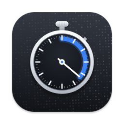
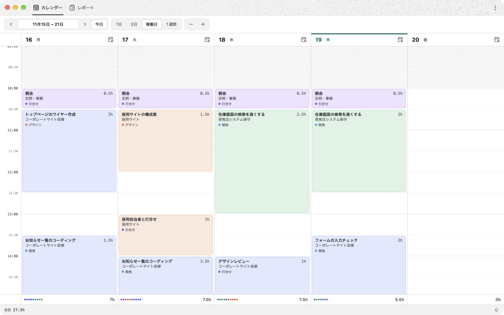
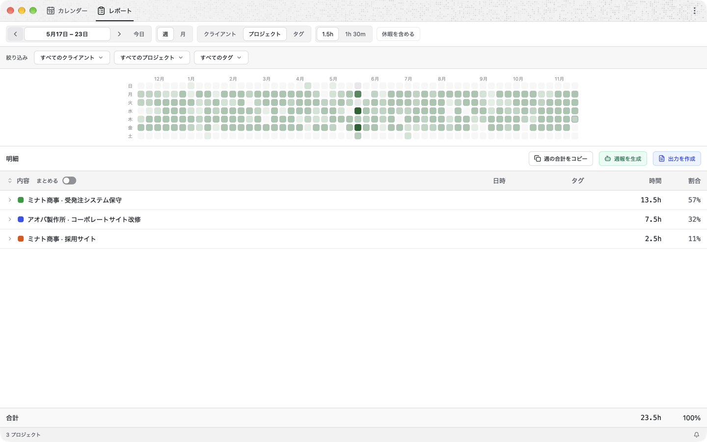

<p align="center">
  
</p>

<h1 align="center">Track</h1>

<p align="center">
  <b>カレンダーに置くだけで、稼働がたまる。</b>
</p>

<p align="center">
  <a href="https://github.com/nemooon/track/releases/latest"></a>
  <a href="#インストール"></a>
  
  
  
</p>

Mac のための稼働記録アプリです。空いた時間に予定のようにブロックを置いていくと、そのまま稼働の記録になります。
記録は自分の Mac の中にだけ保存されます。Codex や Claude Code に「今日の作業を記録して」と頼むこともできます。



## できること

- **カレンダーで記録**：空いた時間をドラッグすると、プロジェクト・タイトル・タグを選ぶ画面が開きます。ブロックはドラッグで動かし、端を引いて長さを変えられます
- **まとめて操作**：Shift クリックや ⌘A で複数を選んで一括削除。右クリックで編集・複製・削除。⌘Z で取り消し、⌘⇧Z でやり直し
- **レポート**：週・月の合計をクライアント・プロジェクト・タグ別に集計。週報のコピーや、AI での週報づくりもできます
- **AI から記録**：Codex と Claude Code 用のスキルを入れると、会話の中から稼働を提案・登録・修正できます。AI がした変更は通知パネルから取り消せます
- **休暇と終日の予定**：休暇（1 日・前半休・後半休）と、1 日まるごとの予定を日付のメニューから入れられます。勤務日の祝日は自動で休暇になります
- **自動バックアップ**：設定した間隔でデータベースの控えを取ります。iCloud Drive にも置けます



## 必要なもの

- macOS 13 以降、Apple シリコン（M1 以降）の Mac
- [Homebrew](https://brew.sh/ja/)
- AI での週報づくりに Apple Intelligence を使う場合は macOS 26 以降（Codex や任意のコマンドも選べます）

## インストール

```bash
brew install --cask nemooon/tap/track
```

Track は Apple の開発者署名をしていないため、初回は macOS に止められることがあります。そのときは次のコマンドを実行してから開いてください。

```bash
xattr -dr com.apple.quarantine /Applications/Track.app
```

## はじめに

1. **設定を開く**（⌘, または右上の「…」メニュー →「設定…」）
2. **カレンダー**で勤務時間と勤務日を決める（初期値は 10:00〜18:30、月〜金）
3. **プロジェクト**でクライアントとプロジェクトを作る（色やタグも付けられます）
4. カレンダーに戻り、空いた時間をドラッグして記録する

## よく使う操作

| 操作 | キー・マウス |
| --- | --- |
| カレンダー／レポートを切り替え | ⌘1 ／ ⌘2 |
| 前の期間・次の期間・今日 | ⌘[ ／ ⌘] ／ ⌘T |
| 時間軸の拡大・縮小 | ⌘+ ／ ⌘- |
| 隣のエントリーを選ぶ | 方向キー（Shift を押すと選択に足す） |
| 表示中のエントリーを全部選ぶ | ⌘A |
| 選んだエントリーを消す | Delete |
| 取り消す・やり直す | ⌘Z ／ ⌘⇧Z |
| 編集・複製・削除 | エントリーを右クリック（ダブルクリックでも編集） |
| 休暇・終日の予定 | 日付の右のアイコン |
| 設定 | ⌘, |

## AI と使う

右上の「…」メニュー →「スキルのインストール…」で、Codex と Claude Code にスキルを入れます。

- **Codex**：`$track` で呼び出します
- **Claude Code**：`/track` で呼び出します

その日の会話から未記録の作業を提案して登録するほか、登録済みの稼働の修正・付け替え・削除、クライアント・プロジェクト・タグの作成もできます。多くの件数を変える操作や削除は、実行前に確認を求めます。AI がした変更は Track の通知パネルに出て、そこから元に戻せます。

## データとバックアップ

- 記録は `~/.track/track.db`（SQLite）に保存されます。外部のサーバーには送りません
- 自動バックアップは、設定の「バックアップと復元」で保存先・間隔・残す数を決められます（初期値は 24 時間ごと、30 個まで）。同じ画面から復元もできます

## アップデート

右上の「…」メニュー →「アップデートを確認…」で、新しい版があればその場で更新できます（隔離属性も Track が外します）。

ターミナルから更新するときは、インストールのときと同じく隔離属性が付き直すので、続けて外してください。

```bash
brew upgrade --cask nemooon/tap/track
```

```bash
xattr -dr com.apple.quarantine /Applications/Track.app
```

### 0.7 以前（Tauri 版）から上げた方へ

- 記録（`~/.track`）はそのまま引き継ぎます
- メモと外部カレンダー連携はなくなりました（データは消えていません）
- AI のスキルは「スキルのインストール…」で入れ直してください

## アンインストール

```bash
brew uninstall --cask track
```

記録（`~/.track`）は残ります。不要なら手で消してください。

## 開発

作り方・構成・リリースの手順は [docs/DEVELOPMENT.md](docs/DEVELOPMENT.md) にあります。不具合や要望は [Issues](https://github.com/nemooon/track/issues) へ（アプリのメニュー「ヘルプ → 問題を報告…」からも開けます）。
